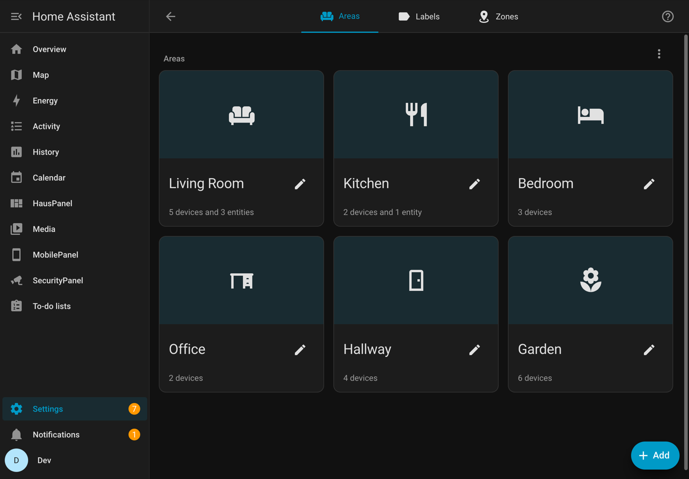
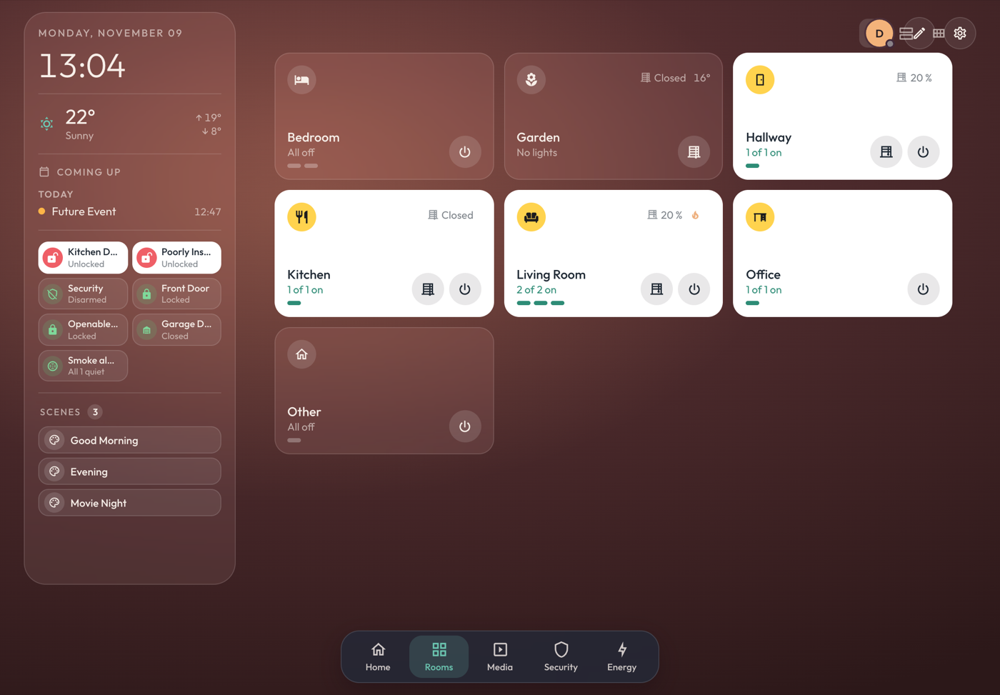
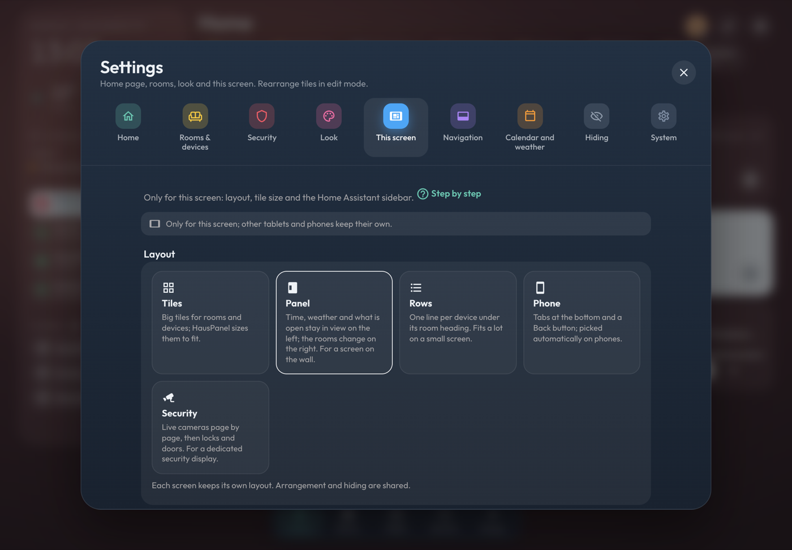
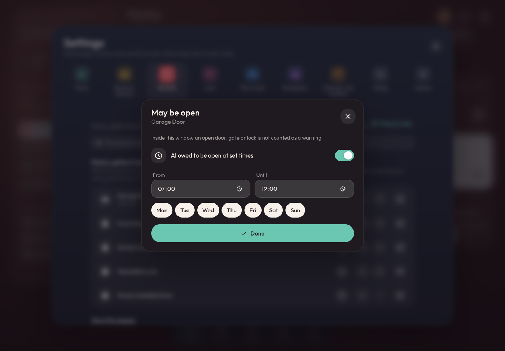
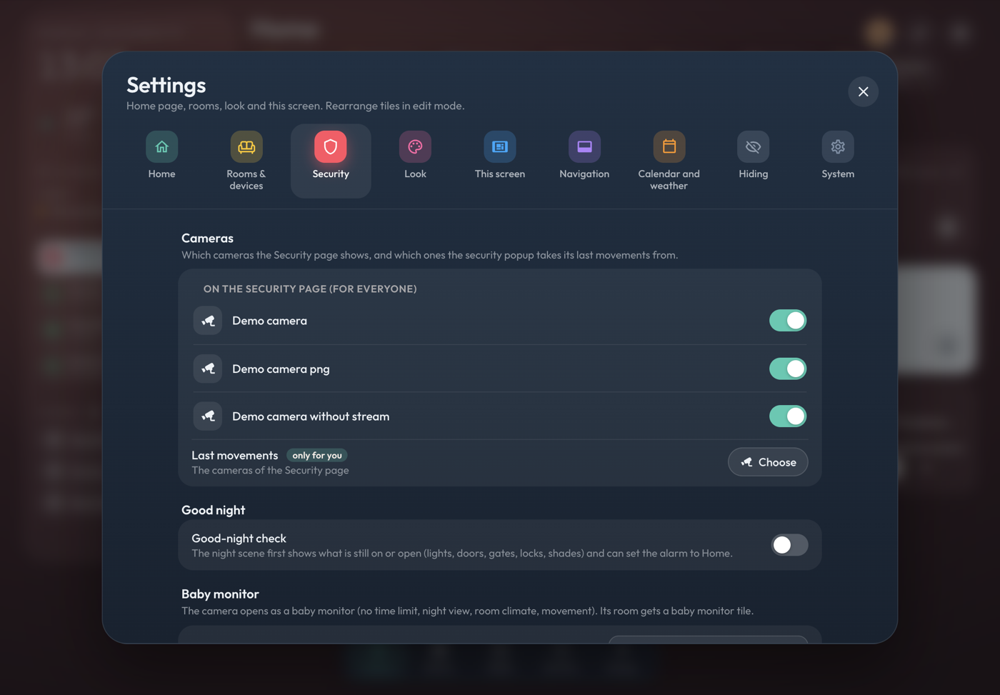
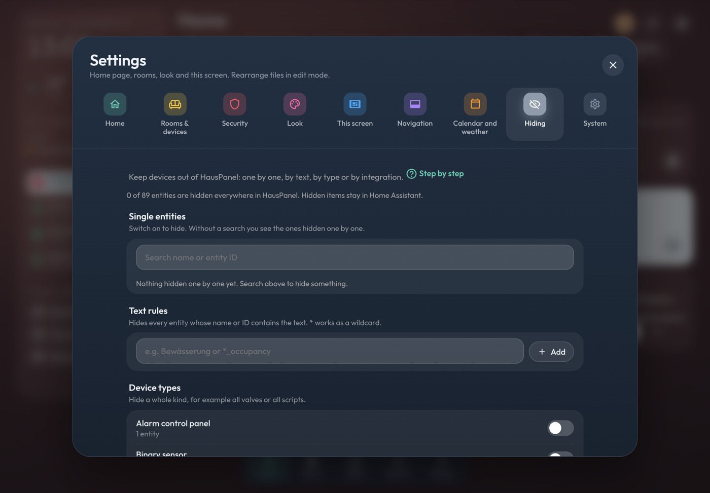
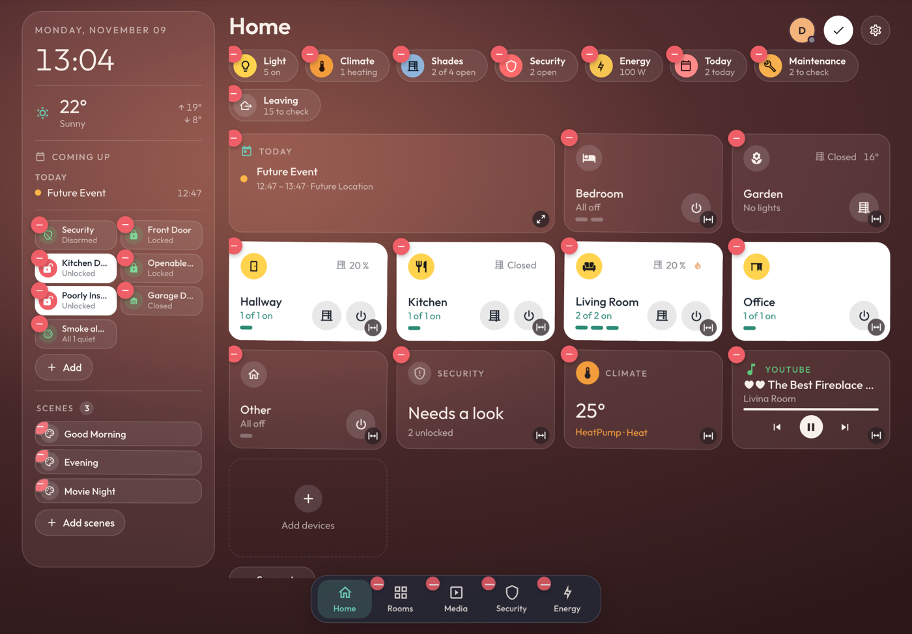
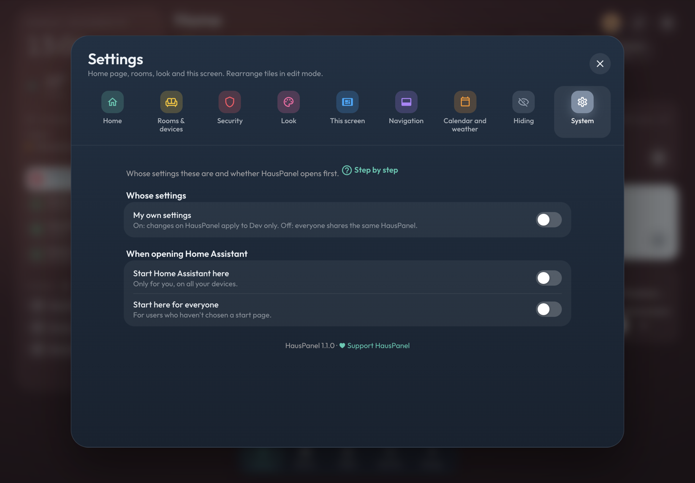

# HausPanel Schritt für Schritt

Kurze Anleitungen zu den Fragen, die am häufigsten kommen. Jeder Reiter in den HausPanel-Einstellungen hat einen Link **Schritt für Schritt**, der zur passenden Anleitung führt.

[English](guides.md) · [Zurück zur README](../README.md#deutsch)

**Inhalt**

1. [Räume und Etagen: woraus HausPanel sich aufbaut](#areas)
2. [Ein Wandtablet](#wall-tablet)
3. [Das Handy](#phone)
4. [Sicherheit](#security)
   - [Ein Tor darf tagsüber offen sein](#allow-open)
   - [Kameras: Sicherheitsseite und letzte Bewegungen](#cameras)
   - [Türklingel](#doorbell)
   - [Babyphone](#baby)
   - [Gute-Nacht-Check](#good-night)
   - [Haus verlassen](#leaving)
5. [Geräte ausblenden](#hiding)
6. [Kacheln anordnen (Bearbeiten-Modus)](#edit)
7. [Eigene Seiten und die Reiter unten](#pages)
8. [Farben und Hintergrund](#look)
9. [Kalender und Wetter](#agenda)
10. [Eigene oder gemeinsame Einstellungen](#own-settings)

---

## 1. Räume und Etagen: woraus HausPanel sich aufbaut

HausPanel hat keine eigene Raumliste. Es zeigt die **Bereiche** aus Home Assistant, sortiert nach **Etagen**, und legt jedes Gerät in den Raum, den sein Bereich angibt. Steht eine Lampe im falschen Raum oder unter *Sonstiges*, liegt die Lösung in Home Assistant, nicht in HausPanel.

1. In Home Assistant **Einstellungen → Bereiche, Labels & Zonen** öffnen.
2. Mit **+ Hinzufügen** deine Etagen und für jeden Raum einen Bereich anlegen und jedem Bereich seine Etage geben. Die Etagen werden zu den Überschriften in der Raumliste.
3. Jedes Gerät öffnen (**Einstellungen → Geräte & Dienste → Geräte**) und seinen **Bereich** setzen. Eine einzelne Entität kann in ihren Einstellungen einen eigenen Bereich haben.
4. In HausPanel sind Räume und Geräte sofort da. Geräte ohne Bereich landen unter **Sonstiges**.

Tipp: Das Raumsymbol in HausPanel ist das Symbol des Bereichs. Du änderst es in den Einstellungen des Bereichs.

**Was ein Tipp auf einen Raum öffnet:** *Einstellungen → Räume & Geräte → Räume öffnen*. **Raum auf einen Blick** öffnet ein Popup mit Temperatur, Licht, Rollos und Szenen; gedrückt halten öffnet die ganze Raumseite. **Ganze Raumseite** macht es umgekehrt. Bei *auf einen Blick* zeigt der Reiter **Räume** alle Räume (als Karten, Zeilen oder kompakt, umschalten oben rechts).

**Bewegung im Raum-Popup** (nur für dich): *Einstellungen → Räume & Geräte → Bewegung im Raum-Popup zeigen*. Räume mit Bewegungs- oder Präsenzmelder zeigen dann *Bewegung jetzt* oder wie lange sie schon ruhig sind.

---

## 2. Ein Wandtablet

1. Auf dem Tablet in der Home-Assistant-Seitenleiste **HausPanel** öffnen.
2. **Einstellungen (Zahnrad) → Dieser Bildschirm**:
   - **Layout**: *Panel* hält Uhrzeit, Wetter und was offen ist links im Blick. *Kacheln* nutzt den ganzen Bildschirm für die Räume.
   - **Kachelgröße**: *Bildschirm füllen* passt alles auf einen Bildschirm.
   - **Home-Assistant-Seitenleiste ausblenden**: gibt HausPanel den ganzen Bildschirm.
   - **Effekte**: *Sparsam* lässt Unschärfe, Leuchten und Dauer-Animationen weg, das hilft älteren oder langsamen Tablets. *Automatisch* schaltet das von selbst ein, wenn der Bildschirm langsam wirkt.
3. **Einstellungen → System → Home Assistant hier starten**, damit das Tablet nach einem Neustart HausPanel öffnet.

*Dieser Bildschirm* wird auf dem Gerät gespeichert: Das Tablet in der Küche und das im Flur können verschiedene Layouts haben.

---

## 3. Das Handy

1. In der Home-Assistant-App in der Seitenleiste **MobilePanel** öffnen. Es hat die Reiter unten und einen Zurück-Knopf.
2. **Einstellungen → System → Home Assistant hier starten** macht es nur auf deinem Handy zur ersten Seite.
3. Der Reiter **Räume** zeigt alle Räume. Für zwei Räume pro Zeile oder kompakte Zeilen auf den Stift tippen (Bearbeiten-Modus): Oben rechts über der Liste erscheinen die Ansichts-Knöpfe.
4. Vom linken Rand hineinwischen geht zurück, wie in anderen Apps.

Die Bildschirmdrehung des iPhones kann eine Webseite nicht sperren. Nutze dafür die Ausrichtungssperre im Kontrollzentrum.

---

## 4. Sicherheit

Alles zu Türen, Toren, Schlössern und Kameras findest du unter **Einstellungen → Sicherheit**.

**Türen, Tore & Schlösser** ist die Liste, die das Sicherheits-Popup im Blick hat. Das Auge blendet etwas aus, die Pfeile sortieren, die Uhr legt ein Zeitfenster fest (nächste Anleitung).
**Sicherheits-Popup** legt fest, welche Teile das Popup hinter dem Chip *Sicherheit* zeigt und in welcher Reihenfolge.

### Ein Tor darf tagsüber offen sein

Ein Einfahrtstor, das tagsüber offen steht, soll den Sicherheits-Chip nicht rot machen.

1. **Einstellungen → Sicherheit → Türen, Tore & Schlösser**.
2. Auf die **Uhr** neben dem Tor tippen.
3. **Zu bestimmten Zeiten offen erlaubt** einschalten, **Von** und **Bis** einstellen und bei Bedarf die Tage wählen.
4. **Fertig**. In diesem Zeitfenster gilt das Tor als in Ordnung, das Popup zeigt es als *erlaubt bis …*. Außerhalb warnt es wie bisher.

Ein Zeitfenster über Mitternacht (22:00 bis 06:00) geht auch.

### Kameras: Sicherheitsseite und letzte Bewegungen

**Einstellungen → Sicherheit → Kameras** hat zwei Teile:

- **Auf der Sicherheitsseite (für alle)**: ein Schalter pro Kamera. Aus heißt: Die Kamera erscheint nicht auf der Sicherheitsseite und im SecurityPanel. Die Reihenfolge änderst du im Bearbeiten-Modus auf der Sicherheitsseite (Bilder ziehen).
- **Letzte Bewegungen** (*nur für dich*): Das Sicherheits-Popup zeigt, was die Kameras zuletzt gesehen haben (dafür braucht es die [Frigate-Integration](https://github.com/blakeblackshear/frigate-hass-integration)). Auf **Auswählen** tippen und die gewünschten Kameras einschalten. Ohne eigene Auswahl nimmt es die Kameras der Sicherheitsseite. **Kameras der Sicherheitsseite** stellt das wieder her.

Die Auswahl für die letzten Bewegungen speichert Home Assistant bei deinem Benutzer. Sie gilt deshalb auf jedem Bildschirm, auf dem du angemeldet bist, und ändert für die anderen nichts. Ist ein Wandtablet mit deinem Benutzer angemeldet, ändert sie sich dort mit.

Dieselbe Liste erreichst du auch im Popup: über das Kamerasymbol neben *Letzte Bewegungen*.

### Türklingel

Erscheint, wenn Home Assistant eine Türklingel kennt (eine *Ereignis*-Entität der Art Türklingel, zum Beispiel von Reolink, UniFi Protect oder Ring).

1. **Einstellungen → Sicherheit → Klingel → Kamera zeigen, wenn es klingelt**.
2. Die **Kamera** wählen, die im Vollbild aufgeht, und, falls vorhanden, den **Öffnen-Knopf** (ein Tor, Garagentor oder Schloss).
3. **Ausprobieren** zeigt, was beim Klingeln passiert.

### Babyphone

1. **Einstellungen → Sicherheit → Babyphone → Kamera**: die Kamera im Kinderzimmer wählen.
2. Den **Raum** prüfen: Seine Temperatur und Luftfeuchte erscheinen im Babyphone, und der Raum bekommt eine Babyphone-Kachel.
3. Das Babyphone hat kein Zeitlimit, eine Nachtansicht und zeigt Bewegung.

### Gute-Nacht-Check

1. **Einstellungen → Sicherheit → Gute-Nacht-Check** einschalten.
2. In Home Assistant eine Szene namens *Gute Nacht* (oder *Schlafen*, *Good night*, *Bedtime*) anlegen.
3. Tippst du auf diese Szene, listet HausPanel zuerst, was noch an oder offen ist (Licht, Türen, Tore, Schlösser, Rollos), jeweils mit einem Knopf zum Erledigen. Dann läuft die Szene und, wenn du willst, geht die Alarmanlage auf *Zuhause*.

### Haus verlassen

Der Chip **Weggehen** auf der Startseite (und der Knopf im Sicherheits-Popup) zeigt, was noch offen, an oder am Spielen ist. **Alles erledigen** schaltet Licht und Musik aus und sperrt die Schlösser. Fenster schließt du selbst. Vorher macht Home Assistant eine Momentaufnahme, damit **Rückgängig** Licht und Musik wieder so herstellt, wie sie waren.

---

## 5. Geräte ausblenden

Ausgeblendete Geräte bleiben in Home Assistant, nur HausPanel lässt sie weg.

- **Eine Kachel**: Stift (Bearbeiten-Modus) → das Minus auf der Kachel. Sie ist nur an dieser Stelle ausgeblendet (in diesem Raum, auf dieser Seite).
- **Überall**: **Einstellungen → Ausblenden**:
  - **Einzelne Entitäten**: suchen und einschalten.
  - **Textregeln**: blendet alles aus, dessen Name oder ID den Text enthält, `*` ist ein Platzhalter (zum Beispiel `*_battery`).
  - **Gerätetypen**: eine ganze Art, zum Beispiel alle Tasten oder alle Skripte.
  - **Integrationen**: alles aus einer Integration.

Zurückholen: denselben Schalter wieder ausschalten, oder im Bearbeiten-Modus der Chip *ausgeblendet* im Raum.

---

## 6. Kacheln anordnen (Bearbeiten-Modus)

Oben rechts auf den **Stift** tippen. Dann:

- Eine Kachel **ziehen**, um sie zu verschieben. Die Reihenfolge gilt pro Raum und pro Seite.
- Das **Minus** blendet sie hier aus.
- Der **Größen-Knopf** in der Ecke einer Kachel ändert ihre Größe.
- **Geräte hinzufügen** holt ein Gerät dazu, das HausPanel nicht von selbst hingelegt hat.
- Das Minus auf einem Status-Chip oder einem Reiter blendet diesen Chip oder Reiter aus.

Der **Haken** beendet den Bearbeiten-Modus. Anordnung und Ausgeblendetes sind auf jedem Bildschirm gleich, nur *Dieser Bildschirm* gilt pro Gerät.

---

## 7. Eigene Seiten und die Reiter unten

- **Einstellungen → Navigation → Reiter unten**: ausschalten, was du nicht brauchst, zum Beispiel *Medien*.
- **Neue Seite**: deine eigene Zusammenstellung von Geräten, zum Beispiel *Garten* oder *Garage*. Sie bekommt einen eigenen Reiter. Im Bearbeiten-Modus füllst du sie mit *Geräte hinzufügen*.

---

## 8. Farben und Hintergrund

**Einstellungen → Aussehen** zeigt jede Änderung sofort hinter dem Fenster: die Kartenfarbe eingeschalteter Räume und Geräte, die Akzentfarbe, den Hintergrund (*Folgt dem Licht* macht ihn wärmer, solange Licht an ist), Ecken, Rahmen und den Glaseffekt. *Klassische Übersichts-Popups* stellt die Popups auf einfache Listen zurück.

---

## 9. Kalender und Wetter

**Einstellungen → Kalender und Wetter**: welche Kalender und Erinnerungslisten auf der Startseite und im Popup *Heute* erscheinen und welche Wetter-Entität genutzt wird. *Automatisch* nimmt die erste, die Home Assistant hat; ohne eine nutzt HausPanel Open-Meteo für den Standort deines Zuhauses.

**Müllabfuhr:** Mit [Waste Collection Schedule](https://github.com/mampfes/hacs_waste_collection_schedule) oder einem Kalender, dessen Name Abfall, Müll, Tonne oder Waste enthält (ein ICS-Link deiner Gemeinde geht auch), erscheint am Vortag und am Abholtag ein Chip **Müll** auf der Startseite, zum Beispiel *Morgen: Gelbe Tonne*. Ein Tipp zeigt die nächsten zwei Wochen. Abschalten unter *Einstellungen → Startseite → Status-Chips*.

---

## 10. Eigene oder gemeinsame Einstellungen

Normalerweise sehen alle im Haushalt dasselbe HausPanel.

- **Einstellungen → System → Eigene Einstellungen nur für mich** einschalten: Ab dann gelten deine Änderungen nur für dich (auf diesem Panel), alle anderen behalten die gemeinsamen Einstellungen. Es startet als Kopie der gemeinsamen.
- Wieder aus: Du siehst die gemeinsamen Einstellungen.
- Ein paar Dinge sind immer deine eigenen, egal was dieser Schalter sagt: die Startseite (*Home Assistant hier starten*), die Kameras für *Letzte Bewegungen* und *Bewegung im Raum-Popup zeigen*.
- *Dieser Bildschirm* gilt immer pro Gerät.

Jeder Reiter sagt oben, für wen eine Änderung gilt: diesen Bildschirm, nur dich oder alle.

**Sichern:** *Einstellungen → System → Sichern* speichert die Einstellungen dieses Panels als Datei und spielt sie wieder ein, zum Beispiel nach dem Umzug auf ein neues Home Assistant. Beim Einspielen werden die aktuellen Einstellungen nach einer Rückfrage ersetzt.

---

Fehlt etwas oder ist etwas unklar? Schreib ein [Issue](https://github.com/alpacalabs-de/hauspanel/issues).
