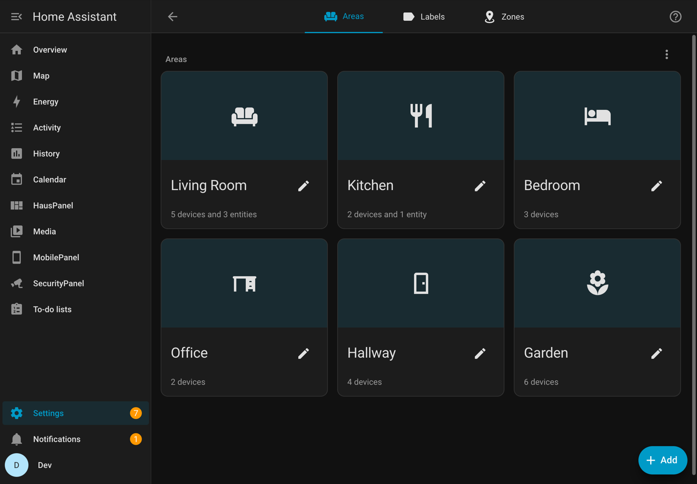
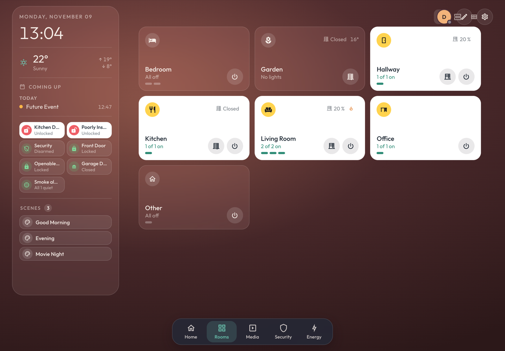
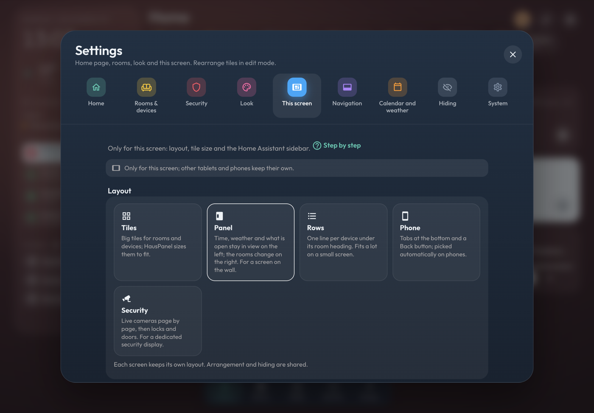
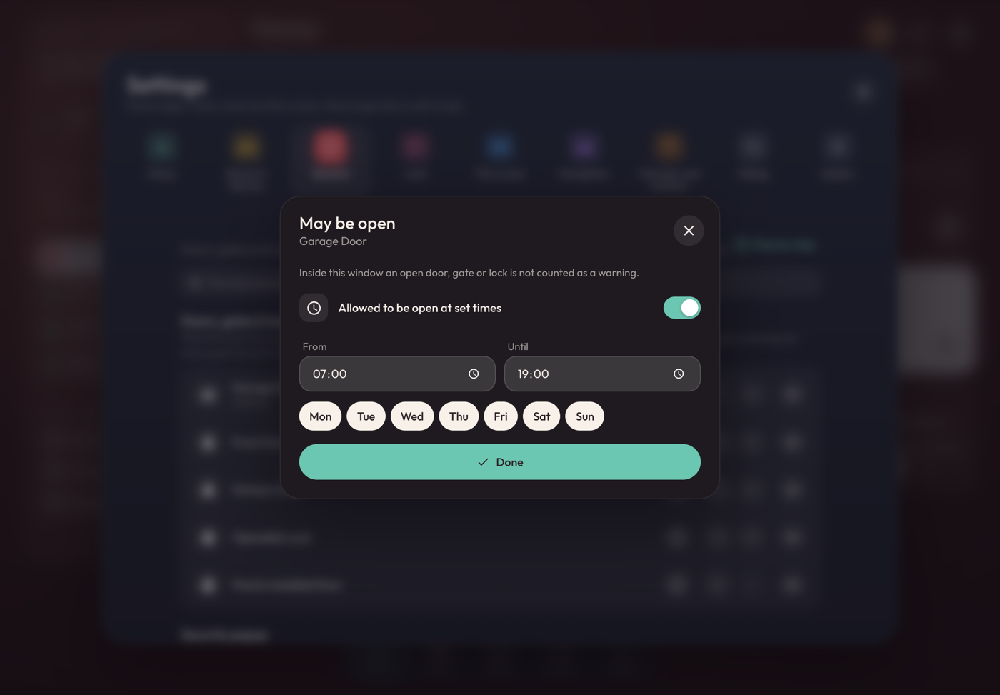
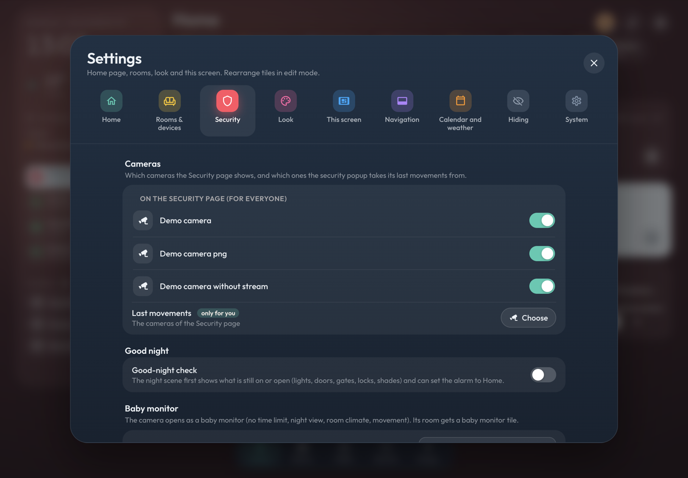
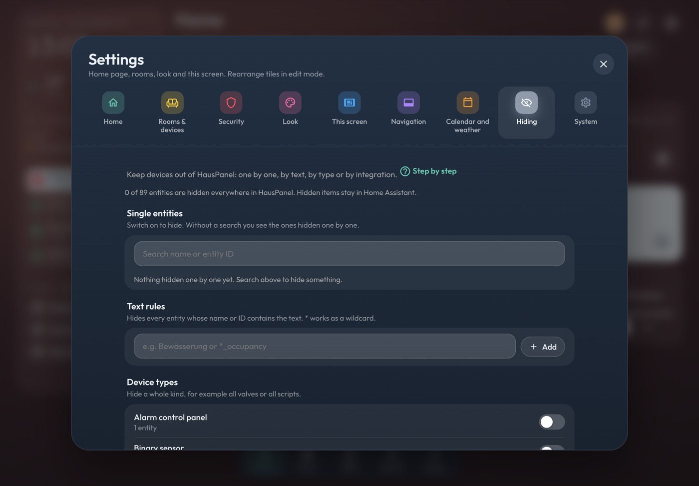
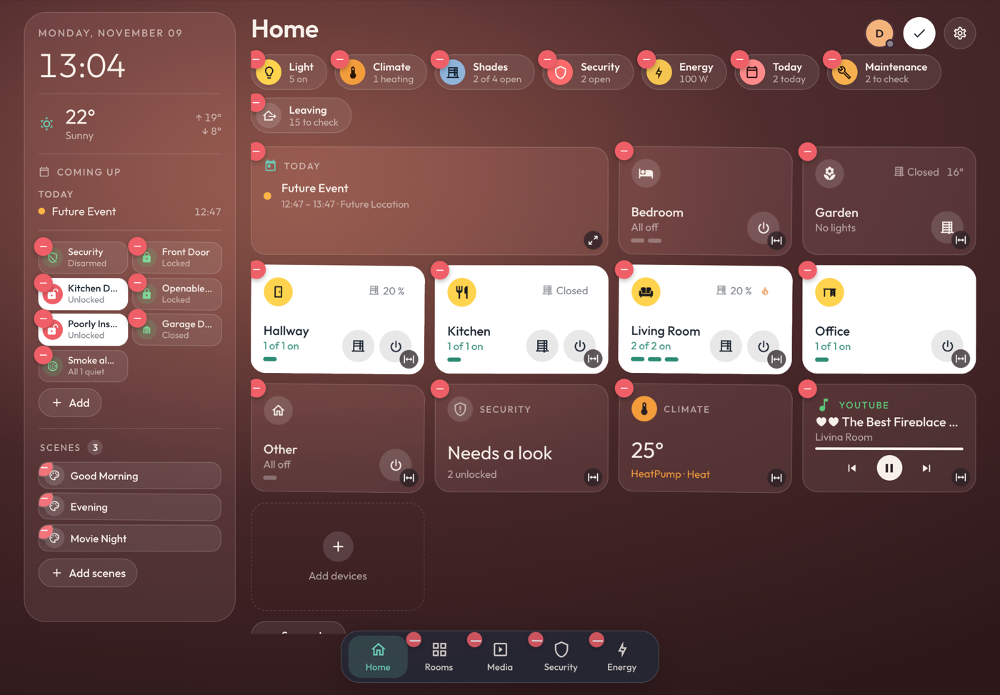
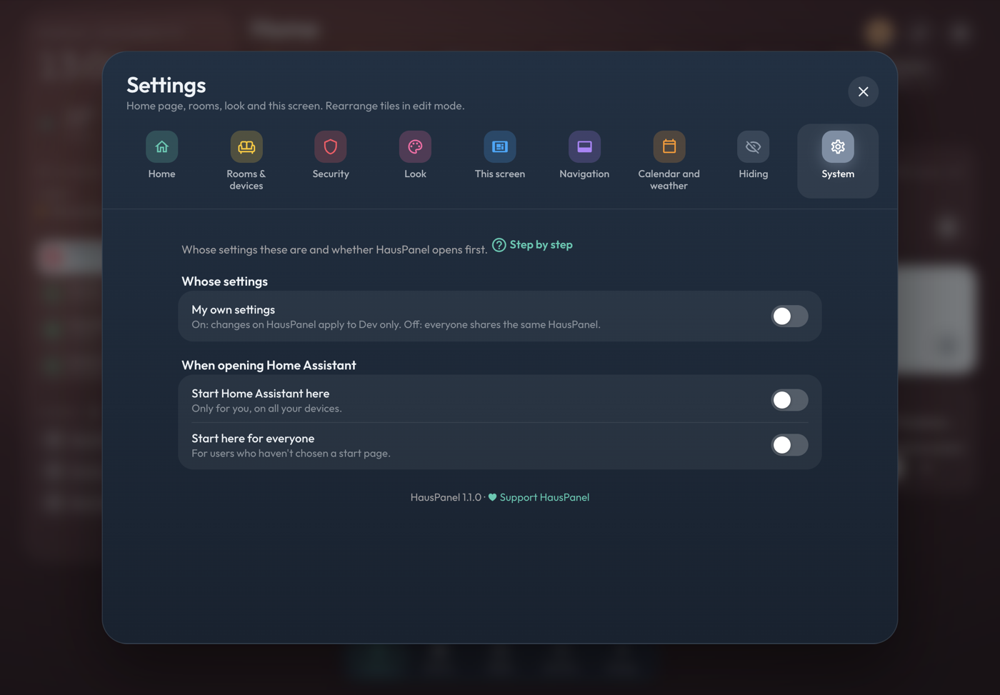

# HausPanel step by step

Short guides for the things people ask most. Every settings tab in HausPanel has a **Step by step** link that leads to the guide that fits it.

[Deutsch](guides.de.md) · [Back to the README](../README.md)

**Contents**

1. [Rooms and floors: what HausPanel builds from](#areas)
2. [A wall tablet](#wall-tablet)
3. [The phone](#phone)
4. [Security](#security)
   - [A gate may be open during the day](#allow-open)
   - [Cameras: Security page and last movements](#cameras)
   - [Doorbell](#doorbell)
   - [Baby monitor](#baby)
   - [Good night check](#good-night)
   - [Leaving home](#leaving)
5. [Hiding devices](#hiding)
6. [Arranging tiles (edit mode)](#edit)
7. [Own pages and the tab bar](#pages)
8. [Colours and background](#look)
9. [Calendars and weather](#agenda)
10. [Own settings or shared ones](#own-settings)

---

## 1. Rooms and floors: what HausPanel builds from

HausPanel has no room list of its own. It shows the **areas** of Home Assistant, sorted by **floor**, and puts each device in the room its area says. If a lamp shows up in the wrong room or under *Other*, the fix is in Home Assistant, not in HausPanel.

1. In Home Assistant open **Settings → Areas, labels & zones**.
2. With **+ Add** create your floors and an area for each room, and give each area its floor. Floors become the headings in the room list.
3. Open each device (**Settings → Devices & services → Devices**) and set its **Area**. A single entity can have its own area in the entity settings.
4. Back in HausPanel the rooms and devices are there right away. Devices without an area land in **Other**.

Tip: the room icon in HausPanel is the area's icon. Change it in the area settings.

**What a tap on a room does:** *Settings → Rooms & devices → Opening rooms*. **Room at a glance** opens a popup with temperature, light, shades and scenes; holding the room opens its full page. **Full room page** does it the other way round. With *at a glance* the **Rooms** tab lists all rooms (as cards, rows or compact, switch at the top right).

**Motion in the room popup** (only for you): *Settings → Rooms & devices → Show motion in the room popup*. Rooms with a motion or presence sensor then show *Motion now* or how long they have been quiet.

---

## 2. A wall tablet

1. On the tablet open **HausPanel** in the Home Assistant sidebar.
2. **Settings (gear) → This screen**:
   - **Layout**: *Panel* keeps time, weather and what is open on the left. *Tiles* uses the whole screen for rooms. With *Panel*, **Side panel** chooses what the left side shows: weather, coming up, what is open, scenes, *On now* and the room list.
   - **Tile size**: *Fill screen* fits everything on one screen.
   - **Hide the Home Assistant sidebar**: gives HausPanel the full screen.
   - **Effects**: *Lite* leaves out blur, glow and endless animations, which helps older or slow tablets. *Automatic* turns it on by itself when the screen seems slow.
3. **Settings → System → Start Home Assistant here**, so the tablet opens HausPanel after a restart.

*This screen* is stored on the device: the kitchen tablet and the hallway tablet can have different layouts.

---

## 3. The phone

1. In the Home Assistant app open **MobilePanel** in the sidebar. It has the tab bar at the bottom and a Back button.
2. **Settings → System → Start Home Assistant here** makes it the first screen on your phone only.
3. The **Rooms** tab shows every room. For two rooms per line or compact rows, tap the pencil (edit mode): the view buttons appear at the top right of the list.
4. Swiping in from the left edge goes back, like in other apps.

The screen rotation of the iPhone can't be locked by a web page. Use the orientation lock in Control Center.

---

## 4. Security

Everything for doors, gates, locks and cameras is in **Settings → Security**.

**Doors, gates & locks** is the list the security popup watches. The eye hides one, the arrows sort them, the clock sets a time window (next guide).
**Security popup** sets which parts the popup behind the *Security* chip shows, and in which order.

### A gate may be open during the day

An entry gate that stands open during the day should not turn the Security chip red.

1. **Settings → Security → Doors, gates & locks**.
2. Tap the **clock** next to the gate.
3. Switch on **Allowed to be open at set times**, set **From** and **Until** and, if you like, the days.
4. **Done**. Inside that window the gate counts as fine; the popup shows it as *allowed until …*. Outside the window it warns as before.

A window that runs past midnight (22:00 to 06:00) works too.

### Cameras: Security page and last movements

**Settings → Security → Cameras** has two parts:

- **On the Security page (for everyone)**: one switch per camera. Off means the camera does not show on the Security page and the SecurityPanel. The order is changed in edit mode on the Security page (drag the pictures).
- **Last movements** (*only for you*): the security popup shows the last things the cameras saw (needs the [Frigate integration](https://github.com/blakeblackshear/frigate-hass-integration)). Tap **Choose** and switch on the cameras you want. Without a choice it uses the cameras of the Security page. **Cameras of the Security page** goes back to that.

The choice for last movements is kept by Home Assistant with your user, so it follows you to every screen where you are signed in and doesn't change anything for the others. If a wall tablet is signed in with your user, it changes there too.

You can also open the same list from the popup: the camera button next to *Last movements*.

### Doorbell

Shows up when Home Assistant has a doorbell (an *event* entity of the doorbell kind, for example from Reolink, UniFi Protect or Ring).

1. **Settings → Security → Doorbell → Show the camera when it rings**.
2. Pick the **Camera** that opens full screen and, if you have one, the **Open button** (a gate, garage door or lock).
3. **Try it** shows what happens when it rings.

### Baby monitor

1. **Settings → Security → Baby monitor → Camera**: pick the camera in the child's room.
2. Check the **room**: its temperature and humidity show in the baby monitor, and the room gets a baby monitor tile.
3. The baby monitor has no time limit, a night view and shows movement.

### Good night check

1. **Settings → Security → Good-night check** on.
2. Have a scene named *Good night* (or *Gute Nacht*, *Schlafen*, *Bedtime*) in Home Assistant.
3. When you tap that scene, HausPanel first lists what is still on or open (lights, doors, gates, locks, shades), each with a button to fix it. Then the scene runs and, if you like, the alarm goes to *Home*.

### Leaving home

The **Leaving** chip on Home (and the button in the security popup) shows what is still open, on or playing. **Do it all** switches lights and music off and locks the locks. Windows you close yourself. Before that Home Assistant takes a snapshot, so **Undo** puts lights and music back as they were.

---

## 5. Hiding devices

Hidden devices stay in Home Assistant; only HausPanel leaves them out.

- **One tile**: pencil (edit mode) → the minus on the tile. It is hidden only in that place (that room, that page).
- **Everywhere**: **Settings → Hiding**:
  - **Single entities**: search and switch on.
  - **Text rules**: hides everything whose name or ID contains the text, `*` is a wildcard (for example `*_battery`).
  - **Device types**: a whole kind, for example all buttons or all scripts.
  - **Integrations**: everything from one integration.

To get something back: the same switch off again, or in edit mode the *hidden* chip of the room.

---

## 6. Arranging tiles (edit mode)

Tap the **pencil** at the top right. Then:

- **Drag** a tile to move it. The order is kept per room and per page.
- **Minus** hides it here.
- The **size button** in the corner of a tile changes its size.
- **Add devices** adds a device that HausPanel didn't put there by itself.
- The minus on a status chip or a tab hides that chip or tab.

The **tick** ends edit mode. Arrangement and hiding are the same on every screen; only *This screen* differs per device.

---

## 7. Own pages and the tab bar

- **Settings → Navigation → Tabs at the bottom**: switch off what you don't need, for example *Media*.
- **New page**: your own collection of devices, for example *Garden* or *Garage*. It gets its own tab. Fill it in edit mode with *Add devices*.

---

## 8. Colours and background

**Settings → Look** shows each change right away behind the window: the card colour of rooms and devices that are on, the highlight colour, the background (*Follow the lights* makes it warmer while lights are on), corners, frames and the glass effect. *Classic overview popups* switches the popups back to plain lists.

---

## 9. Calendars and weather

**Settings → Calendar and weather**: which calendars and reminder lists show on Home and in the *Today* popup, and which weather entity is used. *Automatic* takes the first one Home Assistant has; with none HausPanel uses Open-Meteo for your home's location.

**Waste collection:** with [Waste Collection Schedule](https://github.com/mampfes/hacs_waste_collection_schedule), or any calendar whose name says Abfall, Müll, Waste, Trash or Bin (an ICS link from your town works too), a **Waste** chip shows on Home the day before and on the day of a pickup, for example *Tomorrow: Yellow bin*. A tap shows the next two weeks. Switch the chip off in *Settings → Home → Status chips*.

---

## 10. Own settings or shared ones

By default everyone in the household sees the same HausPanel.

- **Settings → System → My own settings** on: from then on your changes apply only to you (on this panel), everyone else keeps the shared settings. It starts as a copy of the shared ones.
- Off again: you see the shared settings.
- A few choices are always your own, whatever this switch says: the start screen (*Start Home Assistant here*), the cameras for *Last movements* and *Show motion in the room popup*.
- *This screen* is always per device.

Each tab says at the top who a change applies to: this screen, only you, or everyone.

**Back up:** *Settings → System → Back up* saves the settings of this panel as a file and loads them back, for example after moving to a new Home Assistant. Loading replaces the current settings after you confirm.

**Take from another panel:** in the same place, pick a panel (for example MobilePanel) and **House settings** or **Everything**. House settings are what is hidden, when doors may be open, the cameras of the Security page, doorbell, baby monitor, calendars and weather; looks, order and Home stay. Everything copies all of it. Handy when one panel is set up just right.

---

Something missing or unclear? Open an [issue](https://github.com/alpacalabs-de/hauspanel/issues).
